<p align="center">
  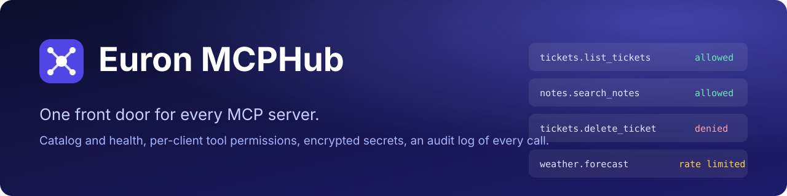
</p>

<p align="center">
  
  <a href="LICENSE"></a>
  
  
  
  
  
  
  
  
</p>

<p align="center">
  <a href="https://github.com/euron-sde-team/euron-mcp-hub/stargazers"></a>
  <a href="https://github.com/euron-sde-team/euron-mcp-hub/fork"></a>
  <a href="https://github.com/euron-sde-team/euron-mcp-hub/watchers"></a>
  <br>
  <a href="https://github.com/euron-sde-team/euron-mcp-hub/issues"></a>
  <a href="https://github.com/euron-sde-team/euron-mcp-hub/pulls"></a>
  <a href="https://github.com/euron-sde-team/euron-mcp-hub/commits/main"></a>
  
  <br>
  <a href="#built-by-the-team-behind-euron"></a>
</p>

<p align="center">
  <b><a href="#-quickstart">Quickstart</a></b> |
  <b><a href="#%EF%B8%8F-architecture">Architecture</a></b> |
  <b><a href="#-explore-the-repository">Explore the repo</a></b> |
  <b><a href="docs/api/openapi.json">API reference</a></b> |
  <b><a href="#%EF%B8%8F-deploy-to-aws">Deploy</a></b> |
  <b><a href="docs/architecture/security.md">Security</a></b> |
  <b><a href="#-documentation">Docs</a></b>
</p>

**Euron MCPHub** is an open-source, MIT-licensed registry and gateway for Model Context Protocol (MCP)
servers, part of the open-source initiative of **ENGAGESPHERE TECHNOLOGY PRIVATE LIMITED**. Register
every MCP server your organisation runs once. Give each agent, IDE and app one URL and one key. The
gateway shows each client only the tools its policy allows, checks the arguments it passes, injects the
upstream credentials the client never sees, and records every call.

It is what a team would otherwise assemble from a list of server URLs in every config file, a pile of
tokens copied into laptops, and the hope that nobody gives an agent a tool it should not have: one place
that knows what exists, who may use it and what happened.

- One endpoint for every tool: `/mcp` is a real MCP server (streamable HTTP, stateless, on the official
  SDK) that aggregates the tools of every registered server as `server.tool`, and proxies calls to them.
- Permissions per client: default deny, rules by pattern where the most specific wins, constraints on the
  arguments a tool may receive, per-rule rate limits, and a dry run that explains a call without making it.
- Secrets that stay secret: upstream tokens are write-only and envelope-encrypted with KMS, bound to their
  server, injected only when the gateway connects, and masked in logs, audit rows and results.
- A gateway you can point at the internet: cloud metadata and private networks are refused unless you
  allow-list them, calls time out, results are size limited, stdio commands need an allow-list entry.
- An audit log of every call, allowed or refused, with redacted arguments, filters, search, CSV export and
  usage charts, plus a record of who changed what.

The whole stack runs on a laptop with no cloud account (KMS and Secrets Manager are emulated and
provisioned by the same Terraform that builds production) and deploys to AWS with one command. Three small
MCP servers ship with it, so the demo, the tests and the screenshots need no external service.

<p align="center">
  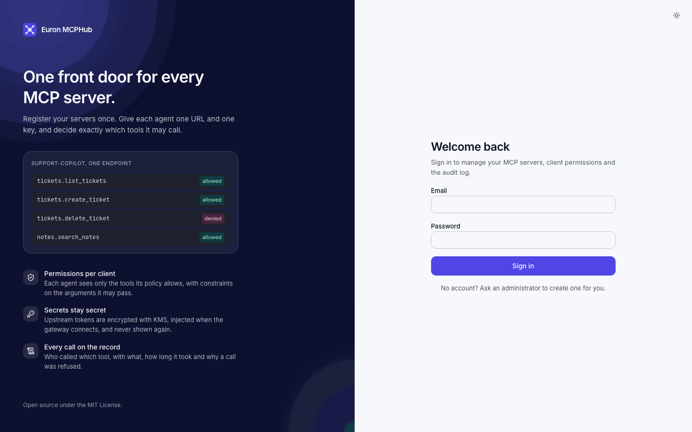
</p>

> [!NOTE]
> Everything in the tour ran for real: Docker Compose on a laptop, KMS and Secrets Manager emulated locally
> and provisioned by the same Terraform modules that build production, five MCP servers discovered and
> health-checked by the worker, and a fortnight of calls sent through the gateway by real MCP clients under
> five different policies. `make up && make demo` reproduces it.

<h3 align="center">Built by the team behind Euron</h3>

<p align="center">Euron MCPHub comes from the people who build these platforms. If you like how this repository is built, come and see what we build with it.</p>

<p align="center">
  <a href="https://euron.one"><picture><source media="(prefers-color-scheme: dark)" srcset="docs/assets/brand/euron-dark.svg"></picture></a>
  <a href="https://euronsystems.com"><picture><source media="(prefers-color-scheme: dark)" srcset="docs/assets/brand/euron-systems-dark.svg"></picture></a>
  <a href="https://alphaeuron.com"><picture><source media="(prefers-color-scheme: dark)" srcset="docs/assets/brand/alpha-euron-dark.svg"></picture></a>
</p>

<p align="center">
  <a href="https://www.instagram.com/euron_official"></a>
  <a href="https://www.linkedin.com/company/euronone/posts/"></a>
  <a href="https://x.com/euron712"></a>
  <a href="https://www.youtube.com/@Euron-official"></a>
  <a href="https://whatsapp.com/channel/0029VaeeJwq9RZAfPW9P2l07"></a>
</p>

---

## 📚 Table of contents

- [Why Euron MCPHub](#-why-euron-mcphub)
- [At a glance](#-at-a-glance)
- [Screenshots](#%EF%B8%8F-screenshots)
- [Features](#-features)
- [Architecture](#%EF%B8%8F-architecture)
  - [Life of a tool call](#life-of-a-tool-call)
  - [Life of a server](#life-of-a-server)
- [Tech stack](#-tech-stack)
- [Prerequisites](#-prerequisites)
- [Quickstart](#-quickstart)
- [Explore the repository](#-explore-the-repository)
- [API](#-api)
- [Configuration](#%EF%B8%8F-configuration)
- [Deploy to AWS](#%EF%B8%8F-deploy-to-aws)
- [Security model](#-security-model)
- [Testing](#-testing)
- [Documentation](#-documentation)
- [Roadmap](#%EF%B8%8F-roadmap)
- [FAQ](#-faq)
- [Contributing, security and license](#-contributing-security-and-license)

---

## 💡 Why Euron MCPHub

MCP makes it easy to give an agent a tool, and teams adopt it one server at a time: a ticketing server here,
a notes server there, a script on someone's laptop. Each agent then carries its own list of URLs and its own
copies of the tokens, nobody can say which agent may call what, and there is no record of what it did.

- **One front door.** Clients configure one URL and one key. Adding, moving or retiring a server is a change
  in one place, not in every agent.
- **Least privilege by default.** A new client can call nothing. Permissions are rules over tools, with the
  arguments constrained, and a tool a client may not use does not appear in its list at all.
- **Credentials stay with the gateway.** Agents never hold the upstream tokens; operators can set them but
  never read them back; a leaked client key exposes one client's permissions, not a credential.
- **A record you can use.** Who called which tool, with what, how long it took and why a call was refused,
  searchable, exportable and bounded by a retention period.
- **Drift is visible.** Every tool definition is fingerprinted. When a server changes a description or a
  schema, MCPHub records a dated version with the diff, because a silently rewritten tool description is how
  an agent gets steered.
- **Runs anywhere.** PostgreSQL and Valkey are the only stores. Locally it all runs on Docker with an AWS
  emulator and no key; on AWS the same Terraform provisions RDS, ElastiCache, KMS and ECS.

## 📊 At a glance

|                    |                                                                                                                                                                                                   |
| ------------------ | ------------------------------------------------------------------------------------------------------------------------------------------------------------------------------------------------- |
| **Apps**           | Dashboard (13 routes), API and MCP gateway in one process, leader-elected worker, operator CLI, three demo MCP servers                                                                            |
| **Gateway**        | Streamable HTTP, stateless, JSON responses; handshake clients (2025-11-25 and earlier) and the per-request 2026-07-28 protocol; `server.tool` or `server__tool` names                             |
| **Policy**         | Default deny, most specific rule wins, six constraint types, per-client and per-rule rate limits, redaction paths, a dry run                                                                      |
| **Secrets**        | Header and environment secrets, write-only; KMS envelope encryption with a server-bound context, Secrets Manager or local AES-GCM                                                                 |
| **Egress**         | Metadata and link-local always refused, private ranges and stdio need an allow-list, timeouts, result size limit, credential scrubbing                                                            |
| **Catalog**        | Streamable HTTP and stdio servers, tools, resources and prompts, fingerprints and dated version diffs, health checks with history                                                                 |
| **Audit**          | Every call recorded off the request path; filters, full-text search, keyset paging, CSV export, retention; admin activity feed                                                                    |
| **Access**         | Admin, operator and viewer roles, sessions with origin checks, client API keys stored as keyed hashes, sign-in lockout                                                                            |
| **Infrastructure** | 10 Terraform modules, 3 environments (local emulator, AWS dev, AWS prod)                                                                                                                          |
| **Tests**          | 103 API unit, 33 web unit, 83 integration (real PostgreSQL, Valkey, KMS and the bundled MCP servers), 22 browser end-to-end, plus a QA crawl of every page at two viewports and in the dark theme |
| **License**        | MIT                                                                                                                                                                                               |

## 🖼️ Screenshots

<table>
  <tr>
    <td width="50%">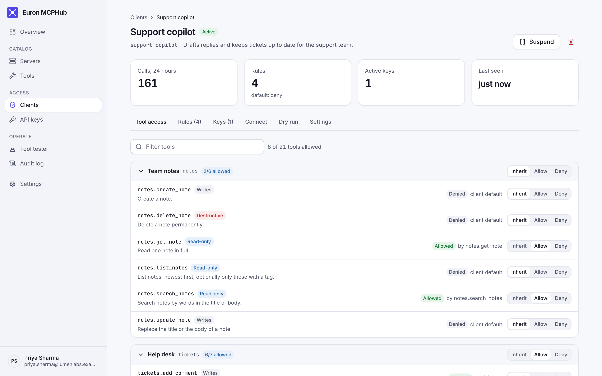<br><sub><b>Permission matrix.</b> Every tool against one client, with the rule that decided it.</sub></td>
    <td width="50%">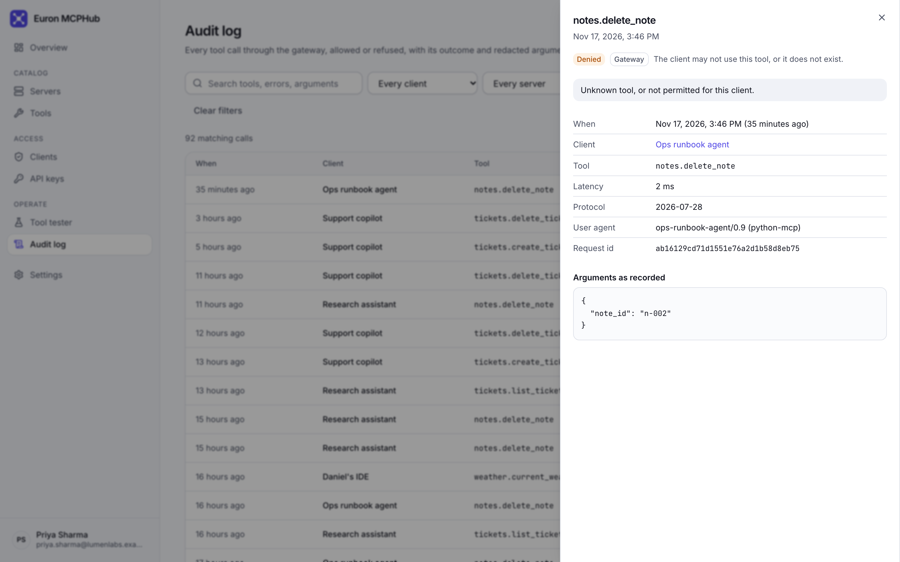<br><sub><b>Audit log.</b> A refused call, why it was refused and its masked arguments.</sub></td>
  </tr>
  <tr>
    <td>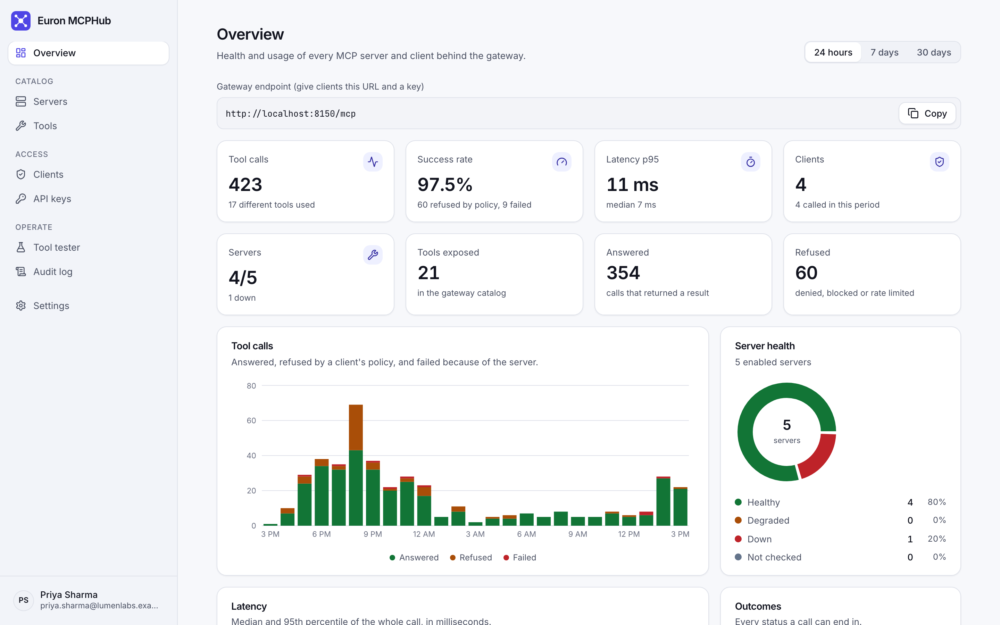<br><sub><b>Overview.</b> Usage, health and latency of everything behind the gateway.</sub></td>
    <td>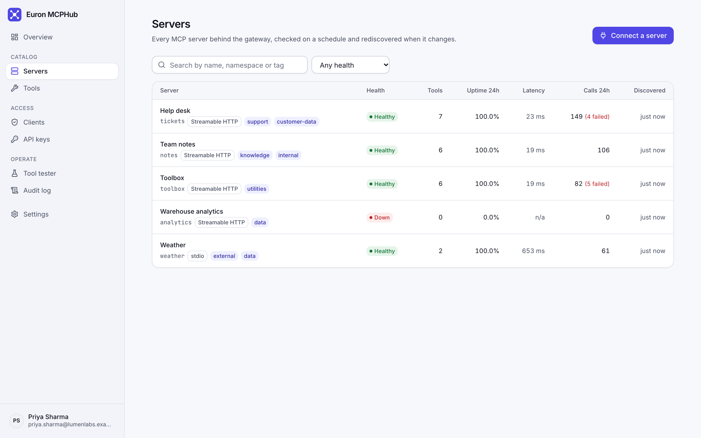<br><sub><b>Servers.</b> The catalog, with health from the worker's checks.</sub></td>
  </tr>
  <tr>
    <td>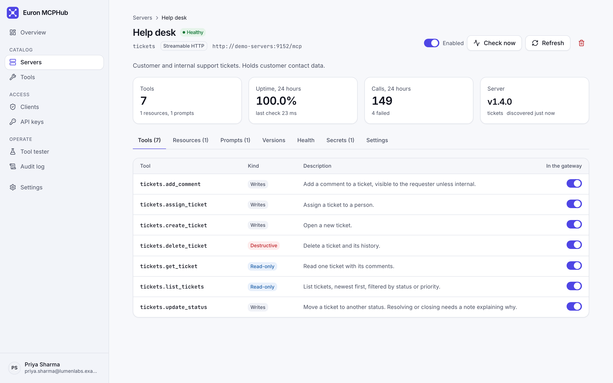<br><sub><b>A server.</b> Tools, resources, prompts, versions, health, secrets.</sub></td>
    <td>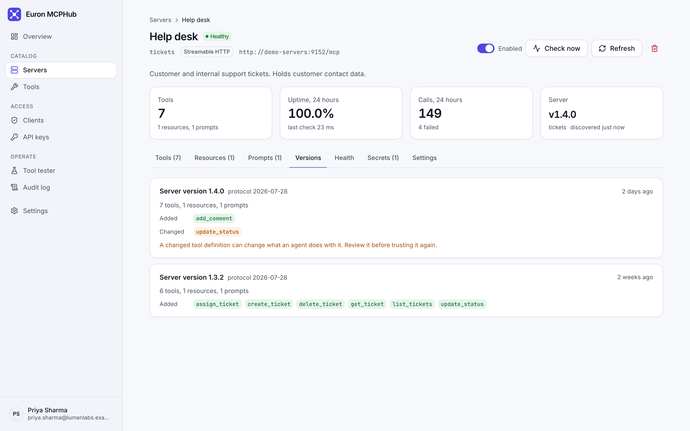<br><sub><b>Versions.</b> What changed in a server, and when discovery saw it.</sub></td>
  </tr>
  <tr>
    <td>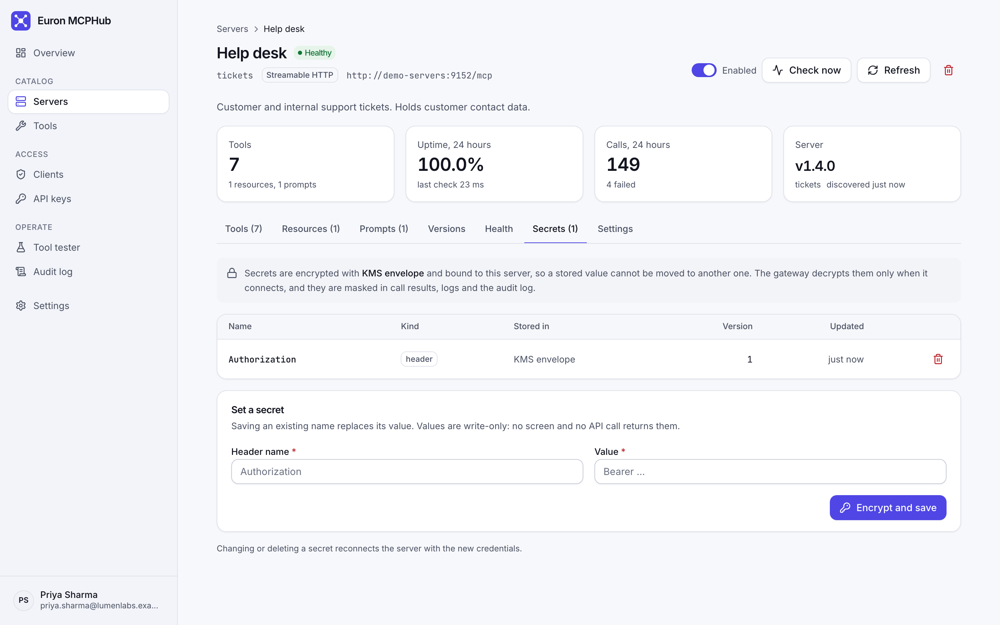<br><sub><b>Secrets.</b> Write-only, encrypted with KMS, bound to the server.</sub></td>
    <td>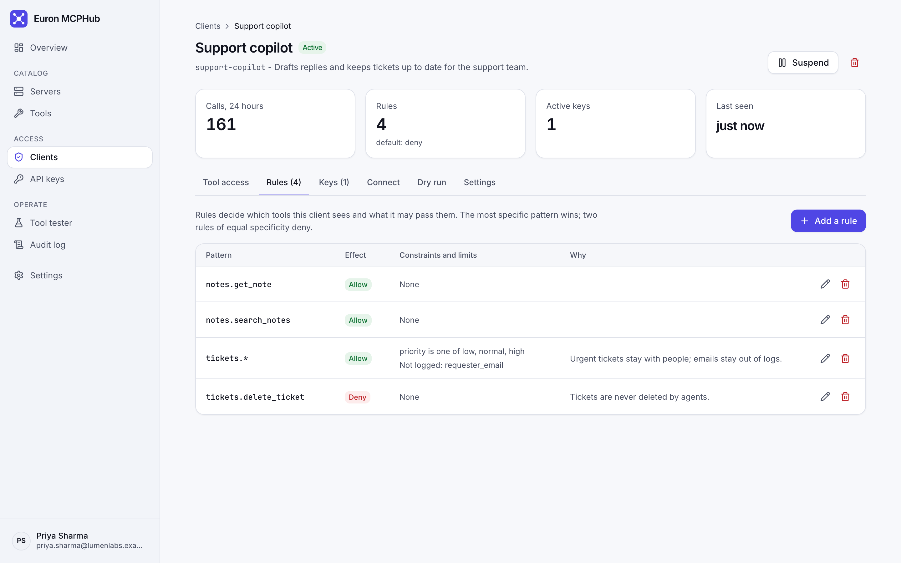<br><sub><b>Rules.</b> Patterns, constraints, limits and what stays out of the log.</sub></td>
  </tr>
  <tr>
    <td>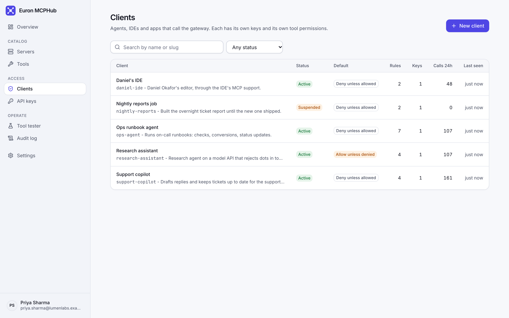<br><sub><b>Clients.</b> Agents, IDEs and jobs, each with its own policy.</sub></td>
    <td>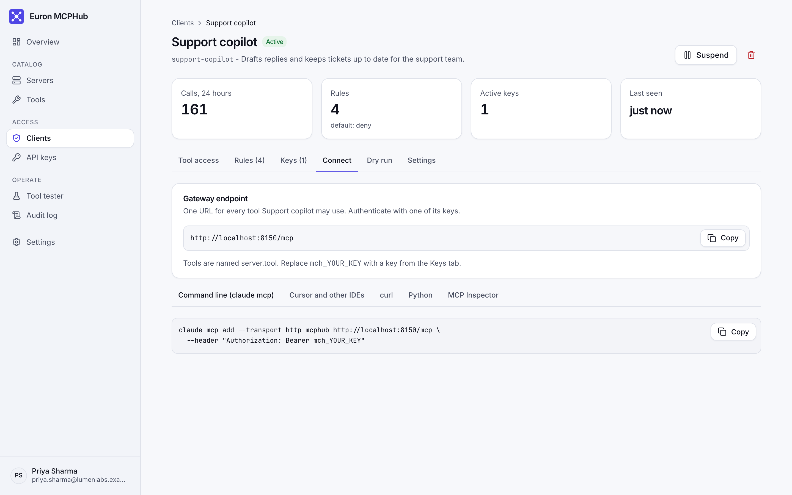<br><sub><b>Connect.</b> Snippets that run as written once a key is filled in.</sub></td>
  </tr>
  <tr>
    <td>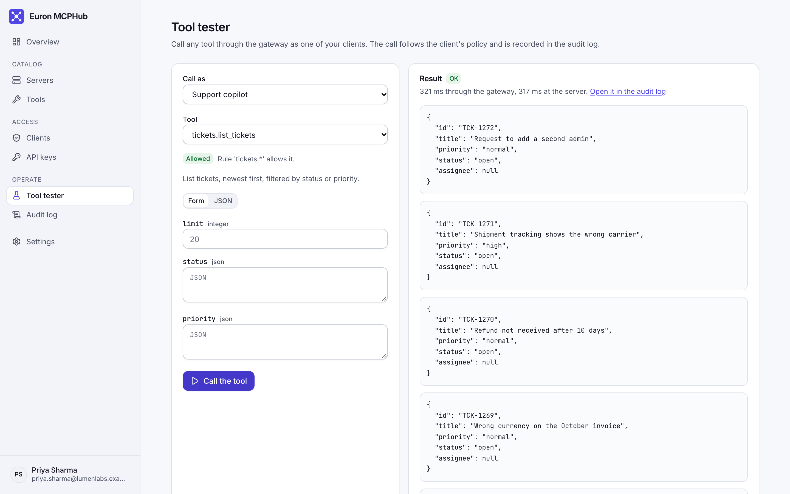<br><sub><b>Tool tester.</b> A real call through the gateway, as a client.</sub></td>
    <td>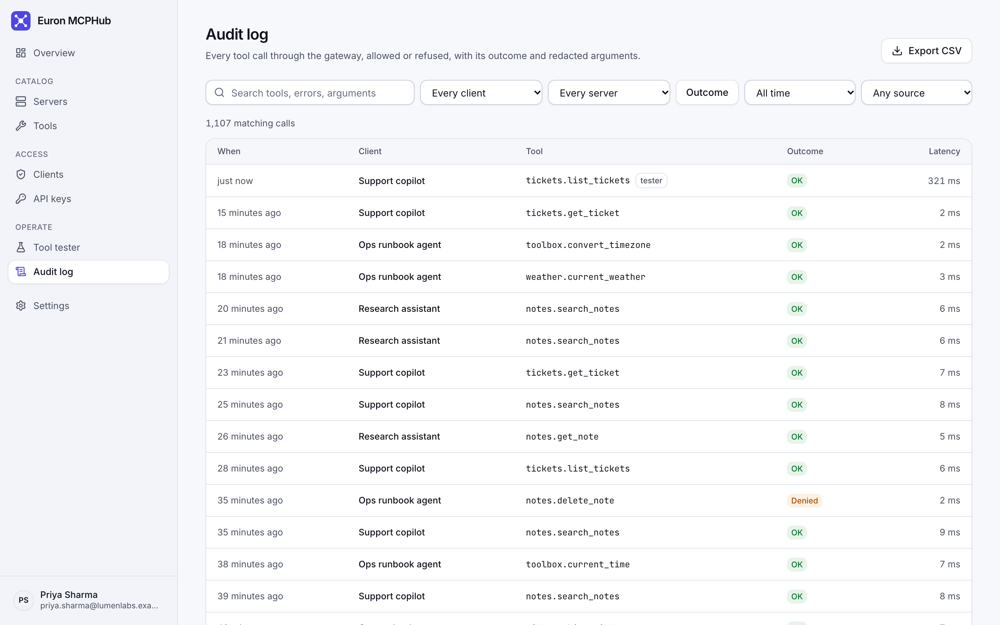<br><sub><b>Audit log.</b> Every call, filterable by client, server, outcome and time.</sub></td>
  </tr>
  <tr>
    <td>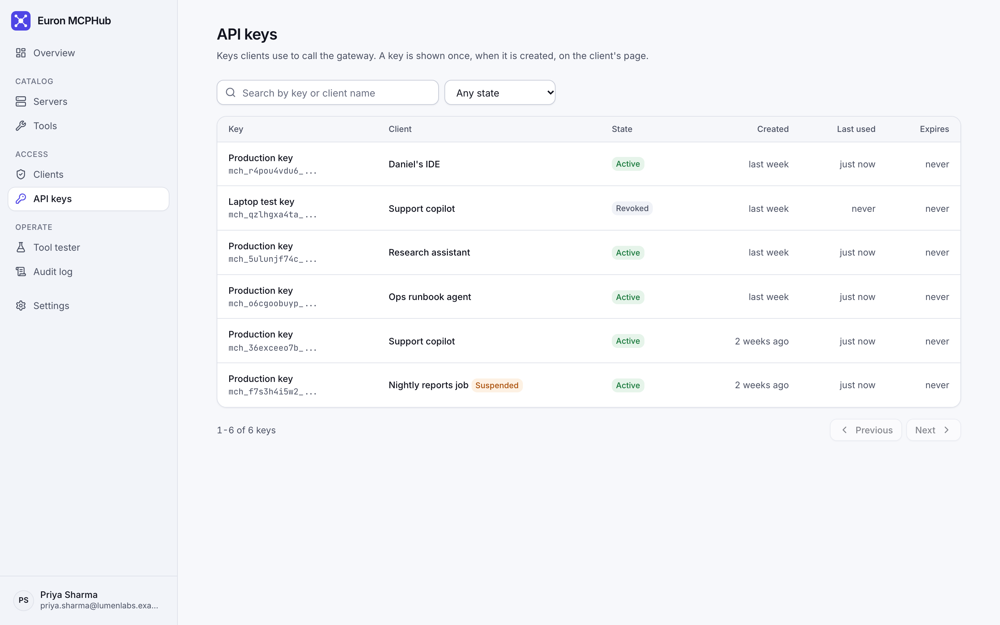<br><sub><b>API keys.</b> Which keys exist, which are live, which went quiet.</sub></td>
    <td>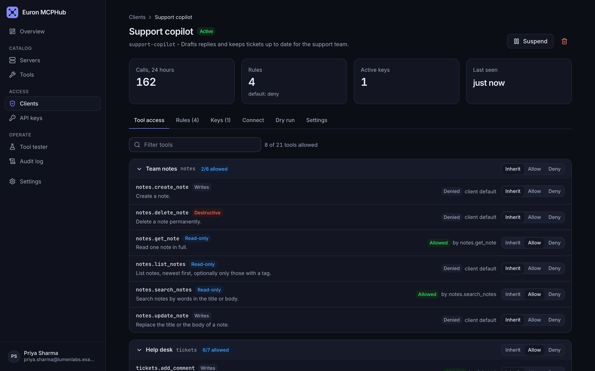<br><sub><b>Dark theme.</b> Follows the system setting, switchable from the account menu.</sub></td>
  </tr>
</table>

## ✨ Features

| Area           | What you get                                                                                                                                                                                                                                                                                |
| -------------- | ------------------------------------------------------------------------------------------------------------------------------------------------------------------------------------------------------------------------------------------------------------------------------------------- |
| **Catalog**    | Register streamable HTTP servers by URL and stdio servers by command; discovery lists tools, resources, resource templates and prompts; tags, owners, per-server timeouts and refresh intervals; switch any tool out of the gateway                                                         |
| **Drift**      | A SHA-256 fingerprint per tool; a dated version record with added, removed and changed tools whenever a server's version or catalog changes                                                                                                                                                 |
| **Health**     | The worker connects, lists tools and records latency on a schedule; three failures mean down; recovery triggers rediscovery; uptime and latency history per server                                                                                                                          |
| **Gateway**    | MCP over streamable HTTP at `/mcp`; tools namespaced `server.tool` or `server__tool`; a pooled connection per upstream, reused across clients, replaced when its configuration or secrets change; a call that fails before reaching the server is retried once, one that fails after is not |
| **Policy**     | Rules by pattern with allow or deny; the most specific wins, ties deny; constraints `equals`, `one_of`, `pattern`, `max_length`, `range`, `forbidden`; per-client and per-rule limits; readable errors a model can act on                                                                   |
| **Secrets**    | Header and environment secrets; KMS envelope encryption with an encryption context, Secrets Manager, or local AES-GCM; replace or delete, never read; reconnect on change                                                                                                                   |
| **Egress**     | Metadata and link-local refused including through DNS; private ranges refused unless allow-listed; stdio needs an allow-listed executable; no credentials in URLs; connect and call timeouts; a result size limit                                                                           |
| **Audit**      | Redacted arguments (by rule path, by key name, by credential shape); status per call (ok, tool error, denied, blocked, invalid arguments, rate limited, upstream error, timeout); latency split into gateway and server; request ids                                                        |
| **Dashboard**  | Overview and charts, catalog and connect flow, server pages, tool search, clients with a permission matrix, rules, keys and snippets, a dry run, a tool tester, the audit log, people and roles, activity; light and dark; usable on a phone                                                |
| **Operations** | Liveness and readiness probes (including the secret store), Prometheus metrics for the API and the worker, JSON logs with request ids, advisory-locked migrations, graceful shutdown, a worker lease with hot standbys                                                                      |

## 🏗️ Architecture

<p align="center">
  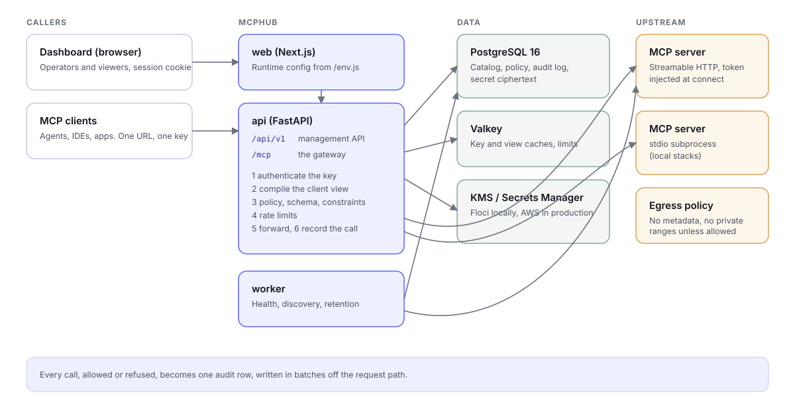
</p>

Three processes run from two images; on AWS the web app, the API and the gateway sit behind one load
balancer on one host name (so the session cookie is first-party and there is no CORS), and the worker has no
inbound path at all:

- **web** (`https://<host>/`): the Next.js dashboard. One image for every environment; it reads the API
  address at run time from `/env.js`.
- **api** (`https://<host>/api/v1`, `https://<host>/mcp`): FastAPI for the management API and the gateway, in
  one process. It applies migrations on boot under an advisory lock and holds one connection per upstream
  server.
- **worker**: the same image with another command. It checks health, rediscovers servers and purges the call
  log, and one worker leads at a time through a lease in Valkey.

[HLD](docs/architecture/HLD.md) | [LLD](docs/architecture/LLD.md) | [Data model](docs/architecture/data-model.md) | [Decision records](docs/architecture/adr/README.md)

### Life of a tool call

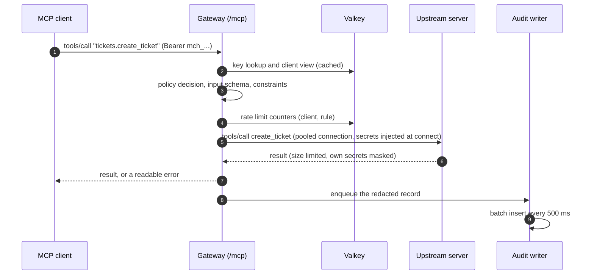

### Life of a server

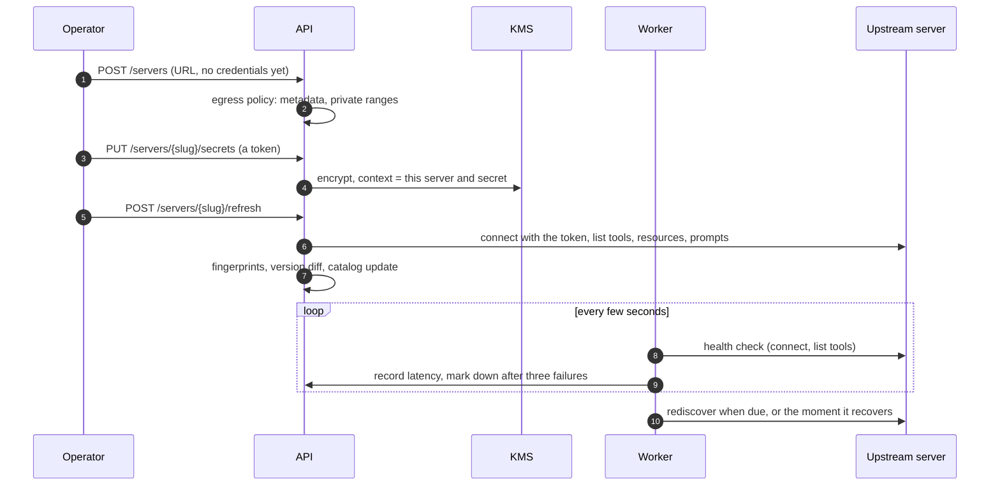

## 🧰 Tech stack

| Layer           | Choice                                                                                                                                                                                     |
| --------------- | ------------------------------------------------------------------------------------------------------------------------------------------------------------------------------------------ |
| API and gateway | Python 3.12, FastAPI, Pydantic v2, SQLAlchemy 2 (async, asyncpg), Alembic, redis-py, the official MCP SDK, httpx, structlog, orjson, prometheus-client, typer, argon2, PyJWT, cryptography |
| Data            | PostgreSQL 16 (full-text search, keyset paging), Valkey 8, KMS and Secrets Manager                                                                                                         |
| Web             | Next.js 16 (App Router, standalone), React 19, TypeScript strict, Tailwind CSS 4, TanStack Query 5, Recharts, Radix                                                                        |
| Tooling         | uv, ruff, mypy (strict), pytest, Hypothesis, pnpm 9, ESLint 9, Prettier, Vitest, Playwright, axe                                                                                           |
| IaC             | Terraform 1.10 or newer, AWS provider 6.x, tflint, checkov; ECS Fargate, RDS, ElastiCache, ALB with WAF                                                                                    |
| Local AWS       | [Floci](https://github.com/floci-io/floci) (`floci/floci:2.3.0`, MIT)                                                                                                                      |

## 📋 Prerequisites

- Docker with Compose v2 (about 4 GB of free memory for the full stack), `make`, `openssl`
- To work on the code: Python 3.12 with [uv](https://docs.astral.sh/uv/), Node.js 22 with pnpm 9 (`corepack enable`)
- No cloud account and no API key

## 🚀 Quickstart

```bash
make up          # Postgres, Valkey, Floci (+ Terraform), api, worker, web, demo servers; the first run builds images
make demo        # five servers, five clients with different permissions, a fortnight of real gateway calls
```

Open http://localhost:3150 and sign in as `priya.sharma@lumenlabs.example` (admin) with the password
`make demo` prints (`daniel.okafor@` is an operator, `mei.lin@` a viewer). The API reference is at
http://localhost:8150/docs, and `make demo` prints a client key and a `curl` for the gateway:

```bash
curl -s http://localhost:8150/mcp \
  -H "authorization: Bearer $KEY" -H "content-type: application/json" \
  -H "accept: application/json, text/event-stream" -H "mcp-protocol-version: 2025-11-25" \
  -d '{"jsonrpc":"2.0","id":1,"method":"tools/list"}'
```

```bash
make test               # unit tests
make test-integration   # real Postgres, Valkey and emulated AWS
make e2e qa             # the browser suites (against the running stack)
make down               # stop and delete the stack's volumes
```

[docs/guides/quickstart-local.md](docs/guides/quickstart-local.md) has the guided tour and
[docs/guides/walkthrough.md](docs/guides/walkthrough.md) the demo, screen by screen.

## 🧭 Explore the repository

```text
euron-mcp-hub/
|-- apps/
|   |-- api/                 FastAPI service, gateway and worker
|   |   |-- src/mcphub/
|   |   |   |-- api/         routes and dependencies
|   |   |   |-- gateway/     the MCP server clients call: SDK server, key authentication
|   |   |   |-- services/    business rules: gateway pipeline, discovery, clients, secrets, call log
|   |   |   |-- repositories/  the only SQL
|   |   |   |-- policy/      patterns, decisions, constraints, redaction, scrubbing (pure)
|   |   |   |-- catalog/     tool fingerprints and version diffs (pure)
|   |   |   |-- upstream/    transports, the connection pool, probes, the egress guard
|   |   |   |-- integrations/  KMS, Secrets Manager and local vaults
|   |   |   |-- demo/        the seeder and the demo MCP servers (notes, toolbox, tickets, weather)
|   |   |   |-- worker.py  cli.py  main.py
|   |   |   `-- migrations/  Alembic
|   |   `-- tests/{unit,integration}
|   `-- web/                 Next.js dashboard (app/(app)/..., components, lib)
|-- e2e/                     Playwright: tests/, qa/ (crawl), capture/ (screenshots, tour GIF)
|-- infra/
|   |-- docker/              api and web images
|   `-- terraform/           modules/ and envs/{local-floci,aws-dev,aws-prod}
|-- deploy/compose/          compose.yaml, compose.floci.yaml (+ Terraform one-shot), compose.aws.yaml
|-- docs/                    architecture/ (HLD, LLD, data model, security, threat model, ADRs), guides/, api/, assets/
`-- scripts/                 env generation, test dependencies, sanitization, AWS deploy
```

## 🔌 API

REST under `/api/v1`, documented in [docs/api/openapi.json](docs/api/openapi.json) and served at `/docs`.
Scripts sign in and send the session token as a bearer token; every error is
`{"error": {"code", "message", "request_id"}}`. MCP clients use `/mcp` with a client key.

```bash
API=http://localhost:8150/api/v1
TOKEN=$(curl -s $API/auth/login -H "content-type: application/json" \
  -d '{"email":"priya.sharma@lumenlabs.example","password":"..."}' | python3 -c 'import json,sys; print(json.load(sys.stdin)["token"])')
curl -s "$API/servers?health=down" -H "Authorization: Bearer $TOKEN"
curl -s "$API/calls?status=denied&limit=5" -H "Authorization: Bearer $TOKEN"
```

[docs/api/README.md](docs/api/README.md) lists the routes and the gateway's responses.

## ⚙️ Configuration

Everything is an environment variable validated at start-up, and `APP_ENV=production` refuses unsafe
settings (development secrets, insecure cookies, open CORS, a local secrets backend, an emulator endpoint, an
`http://` gateway address). The full reference is [docs/guides/configuration.md](docs/guides/configuration.md).
The ones you will touch first:

| Variable                                | Default       | Meaning                                                     |
| --------------------------------------- | ------------- | ----------------------------------------------------------- |
| `UPSTREAM_ALLOWED_HOSTS`                | empty         | Host patterns the gateway may reach on private networks     |
| `STDIO_ALLOWED_COMMANDS`                | empty         | Executables a stdio server may launch; empty disables stdio |
| `SECRETS_BACKEND`, `SECRETS_KMS_KEY_ID` | `local`, none | `kms`, `secretsmanager` or `local` for upstream secrets     |
| `UPSTREAM_MAX_RESULT_BYTES`             | `1048576`     | Larger tool results are refused                             |
| `HEALTH_INTERVAL_S`                     | `30`          | How often each server is checked                            |
| `AUDIT_RETENTION_DAYS`                  | `90`          | How long calls are kept                                     |

## ☁️ Deploy to AWS

```bash
cp infra/terraform/envs/aws-dev/terraform.tfvars.example infra/terraform/envs/aws-dev/terraform.tfvars
make aws-deploy ENV=aws-dev      # registries, ARM64 images, infrastructure, rollout
make aws-cli ENV=aws-dev ARGS="user create --email you@example.com --name You --role admin --password ..."
```

ECS Fargate services behind an ALB (HTTPS, optional WAF), RDS PostgreSQL 16, ElastiCache Valkey, one KMS key
for upstream secrets and storage, Secrets Manager, CloudWatch alarms and a dashboard. See
[docs/guides/deploy-aws.md](docs/guides/deploy-aws.md).

## 🔒 Security model

The gateway is a boundary, so it fails closed. A client sees only its compiled view of the catalog, and a tool
it may not use is indistinguishable from one that does not exist. Upstream secrets are write-only, encrypted
under a context that binds them to their server, and masked wherever text is stored or relayed. A registered
URL cannot reach cloud metadata or a private network unless an operator allow-lists it, and a stdio server
cannot launch anything that is not allow-listed. Passwords use Argon2id, client keys are stored as keyed
hashes, cookies are `httpOnly` and origin-checked, and the process refuses to start in production with unsafe
settings. Read [docs/architecture/security.md](docs/architecture/security.md) and the
[STRIDE threat model](docs/architecture/threat-model.md), and report vulnerabilities as described in
[SECURITY.md](SECURITY.md).

## 🧪 Testing

| Suite                                                                               | Count    | Command                 |
| ----------------------------------------------------------------------------------- | -------- | ----------------------- |
| API unit (pytest, with Hypothesis properties)                                       | 103      | `make test`             |
| Web unit (Vitest)                                                                   | 33       | `make test`             |
| API integration (real PostgreSQL, Valkey, Floci; real MCP servers as upstreams)     | 83       | `make test-integration` |
| Browser end-to-end (Playwright, Chromium)                                           | 22       | `make e2e`              |
| QA crawl (every page, desktop and mobile, plus dark; console, requests, links, axe) | 5 crawls | `make qa`               |

Static checks: ruff, mypy in strict mode, ESLint, Prettier and `tsc` are clean; `make sanitize` and
`make tf-fmt tf-validate` are clean for all three environments, tflint is clean, checkov reports no failed
checks (513 passed, 47 skips, each justified inline), and gitleaks scanned the full history and found no leaks.

Details in [docs/guides/testing.md](docs/guides/testing.md).

## 📖 Documentation

| Topic                                        | Page                                                                                                                                                                                                                                                                                                               |
| -------------------------------------------- | ------------------------------------------------------------------------------------------------------------------------------------------------------------------------------------------------------------------------------------------------------------------------------------------------------------------ |
| Product, containers, flows, deployment       | [HLD](docs/architecture/HLD.md)                                                                                                                                                                                                                                                                                    |
| Modules, algorithms, cache keys, API surface | [LLD](docs/architecture/LLD.md)                                                                                                                                                                                                                                                                                    |
| Tables and indexes                           | [Data model](docs/architecture/data-model.md)                                                                                                                                                                                                                                                                      |
| Controls                                     | [Security](docs/architecture/security.md)                                                                                                                                                                                                                                                                          |
| Threats                                      | [Threat model (STRIDE)](docs/architecture/threat-model.md)                                                                                                                                                                                                                                                         |
| Decisions                                    | [ADRs](docs/architecture/adr/README.md)                                                                                                                                                                                                                                                                            |
| Guides                                       | [Quickstart](docs/guides/quickstart-local.md), [Configuration](docs/guides/configuration.md), [Deploy to AWS](docs/guides/deploy-aws.md), [Operations](docs/guides/operations.md), [Testing](docs/guides/testing.md), [Troubleshooting](docs/guides/troubleshooting.md), [Walkthrough](docs/guides/walkthrough.md) |
| API                                          | [Guide](docs/api/README.md), [OpenAPI](docs/api/openapi.json)                                                                                                                                                                                                                                                      |

## 🗺️ Roadmap

- Proxy resources and prompts through the gateway, not only tools
- Pin the resolved address when connecting upstream, closing the DNS rebinding gap
- OAuth for MCP clients, and per-client upstream credentials
- Sampling and elicitation through the gateway (needs a stateful transport mode)
- Webhooks for health changes and tool drift, and a Python SDK for managing the catalog from code
- Policy templates and a bulk import of servers from an MCP registry

## ❓ FAQ

**Does it need an API key or a cloud account?** No. Docker Compose runs everything, including KMS and Secrets
Manager on an emulator, and the demo MCP servers run offline.

**Which MCP servers can it front?** Any streamable HTTP server, and stdio servers on a host you control. The
gateway aggregates tools; resources and prompts are discovered and shown in the catalog but not proxied yet.

**Why can a client not see a tool it was denied?** Hiding it removes a hint and avoids teaching a model what it
cannot use. The audit log records the real reason for every refusal.

**Can an agent read the upstream token?** No. It never leaves the gateway process, an operator cannot read it back
either, and results that echo it are masked.

**What happens if Valkey or the audit database is down?** Without Valkey the gateway keeps serving from the
database (caches are rebuilt, rate limits fail open). Without the database calls still run and the audit records wait
in a bounded queue; if it fills, records are dropped and counted, never silently.

**Where does my data go?** Postgres (catalog, policy, audit), Valkey (caches), KMS or Secrets Manager (secrets). Nothing
leaves the deployment.

## 🤝 Contributing, security and license

Contributions are welcome: read [CONTRIBUTING.md](CONTRIBUTING.md) and the
[Code of Conduct](CODE_OF_CONDUCT.md). Report vulnerabilities privately as described in
[SECURITY.md](SECURITY.md). Released under the [MIT License](LICENSE). Copyright (c) 2026
ENGAGESPHERE TECHNOLOGY PRIVATE LIMITED and the MCPHub contributors.
