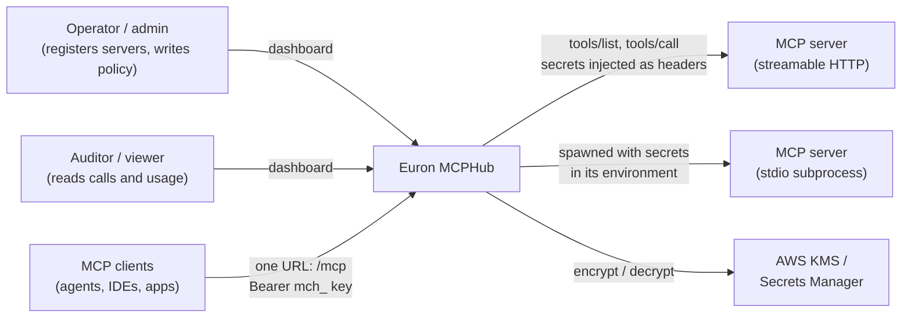
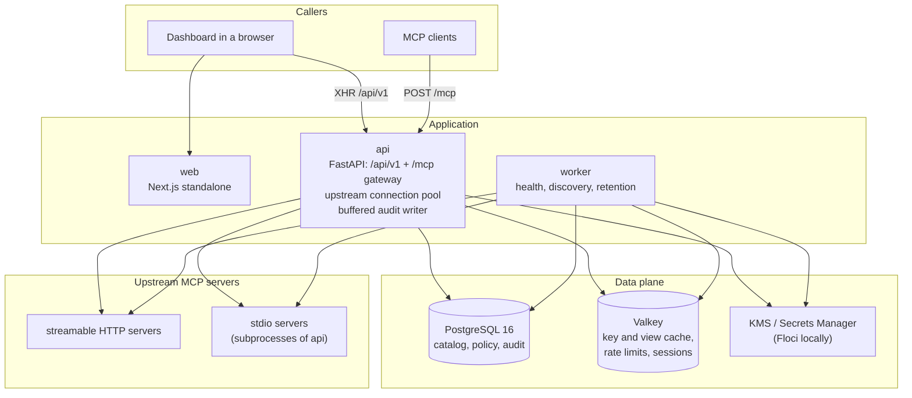
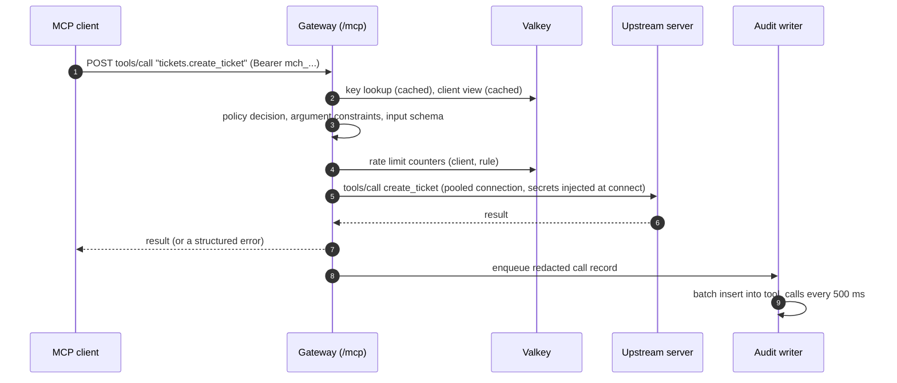

# High-level design

Euron MCPHub is a registry and gateway for Model Context Protocol (MCP) servers. It is an
open-source project from ENGAGESPHERE TECHNOLOGY PRIVATE LIMITED.

Teams adopt MCP one server at a time: a ticketing server here, a notes server there, a
script on someone's laptop. Each agent, IDE and app then carries its own list of server
URLs, its own copies of the tokens those servers need, and no record of what it called.
MCPHub puts one governed front door in front of all of them:

- **A catalog** of every MCP server the organisation runs, over streamable HTTP or stdio,
  with metadata, health checks, and the tools, resources and prompts each one exposes,
  rediscovered on a schedule so drift is visible.
- **One gateway endpoint** (`/mcp`, streamable HTTP) that aggregates the tools of every
  registered server under a namespace (`tickets.create_ticket`), so a client configures a
  single URL and a single key.
- **Per-client policy**: each client (an app, an agent, a person's IDE) has API keys and
  rules that allow or deny tools by pattern, constrain arguments and limit call rates. The
  gateway enforces them on every call and hides what a client may not use.
- **Secrets for upstream servers** (bearer tokens, API keys, headers, environment
  variables) encrypted with AWS KMS or stored in AWS Secrets Manager, injected when the
  gateway connects to the upstream server, and never returned by any API.
- **An audit log** of every tool call: client, tool, arguments (redacted by policy),
  status and latency, searchable and filterable, with usage charts.

This document describes the system as designed: what runs, where data lives, how a call
travels, and how it is deployed. Deeper topics have their own pages:

| Topic                               | Page                               |
| ----------------------------------- | ---------------------------------- |
| Modules, tables, caches, algorithms | [LLD.md](LLD.md)                   |
| Tables and indexes                  | [data-model.md](data-model.md)     |
| Authentication, secrets, hardening  | [security.md](security.md)         |
| STRIDE analysis                     | [threat-model.md](threat-model.md) |
| Decisions and their trade-offs      | [adr/](adr/)                       |

## 1. System context

Three kinds of caller reach MCPHub:

- **People** sign in to the dashboard with an email and password. Roles: `admin` (users and
  everything else), `operator` (servers, secrets, clients, policy) and `viewer` (read-only,
  including the audit log).
- **MCP clients** call the gateway with a client API key (`Authorization: Bearer mch_...`).
  A key identifies exactly one client and its policy; it cannot call the management API.
- **The worker** (no caller of its own) checks health and rediscovers every server on a
  schedule, and enforces audit retention.

## 2. Containers

The repository builds two images. The API image also runs the worker, the operator CLI
and the demo MCP servers with a different command.

| Container                 | Source                               | Listens        | Role                                                                                                                                           |
| ------------------------- | ------------------------------------ | -------------- | ---------------------------------------------------------------------------------------------------------------------------------------------- |
| Web                       | `apps/web` (Next.js)                 | 8080           | Dashboard. Serves `/env.js` with runtime configuration.                                                                                        |
| API                       | `apps/api` (FastAPI)                 | 8080           | Management API `/api/v1`, the MCP gateway `/mcp`, probes and metrics.                                                                          |
| Worker                    | API image, `python -m mcphub.worker` | 9100 (metrics) | Health checks, scheduled discovery, audit retention. Leader-elected through Valkey.                                                            |
| CLI (one-off)             | API image, `mcphub ...`              | none           | `migrate`, `user create`, `demo seed`, `discover`, `openapi`.                                                                                  |
| Demo servers (local only) | API image, `mcphub-demo serve`       | 9150 to 9152   | Three small MCP servers (notes, toolbox, tickets) so the stack works offline. A fourth (weather) is launched over stdio by the gateway itself. |

The web image is environment-agnostic: the API URL and product name are read at request
time from `/env.js`, so one image runs everywhere. The browser calls the API directly, so
the API enforces a CORS allowlist and an Origin check on cookie-authenticated writes.

## 3. The gateway

The gateway is an MCP server built on the official MCP Python SDK (`mcp` 2.x, low-level
`Server`), mounted at `/mcp` inside the API process and served by the SDK's streamable HTTP
session manager in stateless JSON mode. Stateless means any API replica can answer any
request: there is no session affinity to configure behind a load balancer. Both protocol
eras work: handshake clients (`2025-11-25` and earlier) and the per-request
`2026-07-28` protocol.

### Life of a tool call

1. **Authenticate.** The ASGI wrapper in front of the SDK parses the bearer key, finds it
   by prefix (Valkey first, Postgres on a miss), verifies the HMAC of the secret, and
   rejects revoked or expired keys and suspended clients with `401`.
2. **Resolve the client view.** The compiled list of tools this client may see, with the
   rule that admitted each one, is cached in Valkey. It is rebuilt when the client's rules
   change or the catalog changes (a generation counter, not a scan).
3. **Decide.** The tool name is split into server namespace and upstream name. A tool that
   is not in the view is unknown to this client: hidden from `tools/list` and refused on
   `tools/call` exactly like a tool that does not exist.
4. **Validate.** Arguments are checked against the tool's input schema and the rule's
   argument constraints (`one_of`, `equals`, `pattern`, `max_length`, `range`,
   `forbidden`). A violation is returned as a tool error the model can read and correct.
5. **Rate limit.** A fixed-window counter per client and per rule, in Valkey.
6. **Forward.** The upstream pool keeps one MCP client session per server per process,
   opened lazily with the server's secrets decrypted at connect time, multiplexing
   concurrent calls, and closed when idle or when the server's configuration or secrets
   change.
7. **Record.** Every call, allowed or not, becomes a `tool_calls` row: client, key, tool,
   arguments with redaction applied, status, error, latency. Rows are buffered in process
   and written in batches, so the audit trail adds no database round trip to a call.

### Namespacing

Tools are exposed as `<server-slug><separator><tool-name>`. The separator is `.` by
default (valid under the MCP tool-name rules); a client can choose `__` instead for model
APIs that reject dots in function names. Server slugs are lowercase letters, digits and
hyphens, so the first separator is always the boundary and upstream tool names may
contain anything.

## 4. Catalog, discovery and health

- **Registration.** An operator registers a streamable HTTP server by URL, or a stdio
  server by command and arguments. stdio commands must be on the operator-configured
  allowlist (`STDIO_ALLOWED_COMMANDS`): registering one is otherwise remote code execution
  by design. HTTP URLs to link-local and cloud metadata addresses are always refused, loopback and
  private networks are refused unless the host is listed in `UPSTREAM_ALLOWED_HOSTS`, and a tool
  result larger than `UPSTREAM_MAX_RESULT_BYTES` is refused (see the egress policy in
  [security.md](security.md)).
- **Discovery** connects with the server's secrets, negotiates the protocol, and lists
  every page of tools, resources, resource templates and prompts. Each tool definition is
  fingerprinted (name, description, schemas, annotations). When the server's version or
  any fingerprint changes, a version record keeps what was added, removed and changed, so
  a silent change to a tool description (a "rug pull") is visible and dated.
- **Health checks** run every `HEALTH_INTERVAL_S` seconds: connect, list the first page of
  tools, record latency and status. Three consecutive failures mark a server `down`.
- The **worker** schedules both; one worker at a time leads (a Valkey lease), others wait
  as hot standbys. Operators can also refresh or check a server on demand from the API.

## 5. Secrets

Secrets belong to a server and are either an HTTP header (for example `Authorization`)
or an environment variable for a stdio process. Three interchangeable backends:

| Backend          | Where the value lives                                                                                      | Used for                                           |
| ---------------- | ---------------------------------------------------------------------------------------------------------- | -------------------------------------------------- |
| `kms` (default)  | Ciphertext in Postgres, encrypted by a KMS key with an encryption context naming the server and the secret | AWS and the local Floci stack                      |
| `secretsmanager` | One Secrets Manager secret per value; Postgres keeps only its ARN                                          | Teams that rotate secrets in Secrets Manager       |
| `local`          | AES-256-GCM ciphertext in Postgres under a key from the environment                                        | Laptops without an emulator; refused in production |

The API accepts a secret value on write and never returns it: list endpoints return
names, kinds, versions and timestamps only. Plaintext exists only in the memory of the
process that connects to the upstream server, for the lifetime of that connection.

## 6. Data and caching

| Store                 | Holds                                                                                                                                                                                      |
| --------------------- | ------------------------------------------------------------------------------------------------------------------------------------------------------------------------------------------ |
| PostgreSQL 16         | Users, servers, secrets (ciphertext or ARN), discovered tools, resources and prompts, version history, health history, clients, keys (HMAC only), policy rules, tool calls, admin activity |
| Valkey                | Key lookups (5 minutes), compiled client views (2 minutes, generation-keyed), rate-limit windows, signed-out session ids, the worker leader lease, overview statistics (30 seconds)        |
| KMS / Secrets Manager | Upstream secrets                                                                                                                                                                           |

Valkey is a cache, never the source of truth: every key in it can be rebuilt from
Postgres, and losing it costs one database round trip per cold key.

## 7. Deployment

`make up` runs the whole stack in Docker Compose with KMS and Secrets Manager on the Floci
emulator, provisioned by the same Terraform modules that build AWS. On AWS the stack runs
on ECS Fargate behind one Application Load Balancer (with WAF), with RDS PostgreSQL,
ElastiCache (Valkey), KMS and Secrets Manager. Environments: `local-floci`, `aws-dev` and
`aws-prod`. See [the deployment guide](../guides/deploy-aws.md).

## 8. Out of scope for this version

- Proxying resources and prompts through the gateway (they are discovered and shown in
  the catalog; only tools are aggregated).
- Server-to-client requests through the gateway (sampling, elicitation): the gateway
  answers in JSON mode, so an upstream tool that needs them fails with a clear error.
- OAuth for MCP clients (clients use API keys) and per-client upstream credentials (a
  server's secrets are shared by every client allowed to call it).
