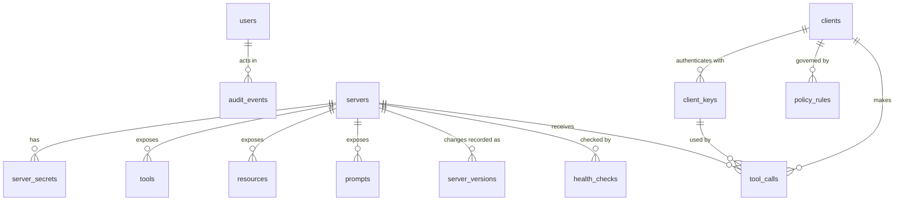

# Data model

PostgreSQL 16 is the system of record. Every primary key is a UUIDv7 (time-ordered, so new
rows append to the index instead of scattering across it). Value sets are `text` columns with
`CHECK` constraints, timestamps are `timestamptz`, and the schema is built by one Alembic
revision under `apps/api/src/mcphub/migrations/`, applied in-process under an advisory lock so
any number of API replicas can boot together.

## Design notes

- **Secrets are never plaintext.** `server_secrets` holds a KMS ciphertext (`ciphertext`), or a
  Secrets Manager ARN (`secret_arn`), plus the backend name and the key reference. The
  application has no column, query or response that could return a value.
- **Keys are hashed.** `client_keys.secret_hash` is an HMAC-SHA256 of the secret part under a
  server-side pepper. The `prefix` is the public lookup handle (`mch_<prefix>_<secret>`).
- **The call log outlives what it points at.** `tool_calls` carries the client and server
  names and slugs as text next to the foreign keys, and the keys are `ON DELETE SET NULL`:
  deleting a client or a server never deletes its history.
- **Tools are soft-removed.** A tool a server stops listing gets `removed_at`; its
  fingerprint history stays, and the gateway no longer exposes it.
- **Full-text search without a service.** `tool_calls.search` is a generated `tsvector` over
  names, error text and arguments, indexed with GIN.
- **Hot-path indexes.** The call log is read by time, by client, by server and by status, and each
  has a composite index ending in `created_at`. Pages use a keyset cursor over
  `(created_at, id)`, never `OFFSET`.
- **Retention.** The worker deletes `tool_calls` older than `AUDIT_RETENTION_DAYS` and
  `health_checks` older than seven days in batches of 5,000 rows.

## Tables

Generated from the SQLAlchemy models (`apps/api/src/mcphub/models/`).

### audit_events

| Column          | Type         | Notes                                 |
| --------------- | ------------ | ------------------------------------- |
| `actor_user_id` | uuid         | references users (on delete set null) |
| `actor_name`    | varchar(120) | not null                              |
| `action`        | varchar(64)  | not null                              |
| `target_type`   | varchar(32)  | not null                              |
| `target_id`     | varchar(64)  |                                       |
| `target_name`   | varchar(200) |                                       |
| `details`       | jsonb        | not null                              |
| `created_at`    | datetime     | not null                              |
| `id`            | uuid         | primary key                           |

Indexes: `ix_audit_events_created_at` (created_at)

### client_keys

| Column         | Type        | Notes                                            |
| -------------- | ----------- | ------------------------------------------------ |
| `client_id`    | uuid        | references clients (on delete cascade), not null |
| `name`         | varchar(80) | not null                                         |
| `prefix`       | varchar(16) | unique, not null                                 |
| `secret_hash`  | varchar(64) | not null                                         |
| `created_by`   | uuid        | references users (on delete set null)            |
| `created_at`   | datetime    | not null                                         |
| `last_used_at` | datetime    |                                                  |
| `expires_at`   | datetime    |                                                  |
| `revoked_at`   | datetime    |                                                  |
| `id`           | uuid        | primary key                                      |

Indexes: `ix_client_keys_client_id` (client_id)

### clients

| Column                  | Type         | Notes                                 |
| ----------------------- | ------------ | ------------------------------------- |
| `slug`                  | varchar(48)  | unique, not null                      |
| `name`                  | varchar(120) | not null                              |
| `description`           | text         | not null                              |
| `status`                | varchar(16)  | not null                              |
| `default_effect`        | varchar(8)   | not null                              |
| `tool_separator`        | varchar(4)   | not null                              |
| `rate_limit_per_minute` | integer      |                                       |
| `record_arguments`      | boolean      | not null                              |
| `policy_version`        | integer      | not null                              |
| `created_by`            | uuid         | references users (on delete set null) |
| `last_seen_at`          | datetime     |                                       |
| `id`                    | uuid         | primary key                           |
| `created_at`            | datetime     | not null                              |
| `updated_at`            | datetime     | not null                              |

### health_checks

| Column       | Type     | Notes                                            |
| ------------ | -------- | ------------------------------------------------ |
| `server_id`  | uuid     | references servers (on delete cascade), not null |
| `ok`         | boolean  | not null                                         |
| `latency_ms` | integer  |                                                  |
| `error`      | text     |                                                  |
| `checked_at` | datetime | not null                                         |
| `id`         | uuid     | primary key                                      |

Indexes: `ix_health_checks_server_id_checked_at` (server_id, checked_at); `ix_health_checks_checked_at` (checked_at)

### policy_rules

| Column                  | Type         | Notes                                            |
| ----------------------- | ------------ | ------------------------------------------------ |
| `client_id`             | uuid         | references clients (on delete cascade), not null |
| `pattern`               | varchar(260) | not null                                         |
| `effect`                | varchar(8)   | not null                                         |
| `constraints`           | jsonb        | not null                                         |
| `rate_limit_per_minute` | integer      |                                                  |
| `redact`                | jsonb        | not null                                         |
| `description`           | varchar(300) | not null                                         |
| `id`                    | uuid         | primary key                                      |
| `created_at`            | datetime     | not null                                         |
| `updated_at`            | datetime     | not null                                         |

### prompts

| Column          | Type         | Notes                                            |
| --------------- | ------------ | ------------------------------------------------ |
| `server_id`     | uuid         | references servers (on delete cascade), not null |
| `name`          | varchar(128) | not null                                         |
| `title`         | varchar(200) |                                                  |
| `description`   | text         | not null                                         |
| `arguments`     | jsonb        | not null                                         |
| `first_seen_at` | datetime     | not null                                         |
| `last_seen_at`  | datetime     | not null                                         |
| `removed_at`    | datetime     |                                                  |
| `id`            | uuid         | primary key                                      |

### resources

| Column          | Type          | Notes                                            |
| --------------- | ------------- | ------------------------------------------------ |
| `server_id`     | uuid          | references servers (on delete cascade), not null |
| `uri`           | varchar(1000) | not null                                         |
| `name`          | varchar(200)  | not null                                         |
| `title`         | varchar(200)  |                                                  |
| `description`   | text          | not null                                         |
| `mime_type`     | varchar(120)  |                                                  |
| `is_template`   | boolean       | not null                                         |
| `first_seen_at` | datetime      | not null                                         |
| `last_seen_at`  | datetime      | not null                                         |
| `removed_at`    | datetime      |                                                  |
| `id`            | uuid          | primary key                                      |

### server_secrets

| Column       | Type         | Notes                                            |
| ------------ | ------------ | ------------------------------------------------ |
| `server_id`  | uuid         | references servers (on delete cascade), not null |
| `kind`       | varchar(8)   | not null                                         |
| `name`       | varchar(128) | not null                                         |
| `backend`    | varchar(16)  | not null                                         |
| `ciphertext` | blob         |                                                  |
| `secret_arn` | varchar(400) |                                                  |
| `key_ref`    | varchar(200) |                                                  |
| `version`    | integer      | not null                                         |
| `created_by` | uuid         | references users (on delete set null)            |
| `updated_by` | uuid         | references users (on delete set null)            |
| `id`         | uuid         | primary key                                      |
| `created_at` | datetime     | not null                                         |
| `updated_at` | datetime     | not null                                         |

### server_versions

| Column             | Type        | Notes                                            |
| ------------------ | ----------- | ------------------------------------------------ |
| `server_id`        | uuid        | references servers (on delete cascade), not null |
| `server_version`   | varchar(80) |                                                  |
| `protocol_version` | varchar(20) |                                                  |
| `catalog_hash`     | varchar(64) | not null                                         |
| `tool_count`       | integer     | not null                                         |
| `resource_count`   | integer     | not null                                         |
| `prompt_count`     | integer     | not null                                         |
| `tools_added`      | jsonb       | not null                                         |
| `tools_removed`    | jsonb       | not null                                         |
| `tools_changed`    | jsonb       | not null                                         |
| `created_at`       | datetime    | not null                                         |
| `id`               | uuid        | primary key                                      |

Indexes: `ix_server_versions_server_id_created_at` (server_id, created_at)

### servers

| Column                 | Type         | Notes                                 |
| ---------------------- | ------------ | ------------------------------------- |
| `slug`                 | varchar(48)  | unique, not null                      |
| `name`                 | varchar(120) | not null                              |
| `description`          | text         | not null                              |
| `transport`            | varchar(16)  | not null                              |
| `url`                  | varchar(500) |                                       |
| `command`              | varchar(300) |                                       |
| `args`                 | jsonb        | not null                              |
| `env`                  | jsonb        | not null                              |
| `headers`              | jsonb        | not null                              |
| `tags`                 | array        | not null                              |
| `owner`                | varchar(120) | not null                              |
| `homepage_url`         | varchar(500) |                                       |
| `enabled`              | boolean      | not null                              |
| `timeout_s`            | integer      | not null                              |
| `refresh_interval_s`   | integer      | not null                              |
| `config_version`       | integer      | not null                              |
| `health`               | varchar(16)  | not null                              |
| `consecutive_failures` | integer      | not null                              |
| `last_check_at`        | datetime     |                                       |
| `last_healthy_at`      | datetime     |                                       |
| `last_latency_ms`      | integer      |                                       |
| `last_error`           | text         |                                       |
| `server_name`          | varchar(200) |                                       |
| `server_version`       | varchar(80)  |                                       |
| `protocol_version`     | varchar(20)  |                                       |
| `instructions`         | text         |                                       |
| `capabilities`         | jsonb        | not null                              |
| `catalog_hash`         | varchar(64)  |                                       |
| `last_discovered_at`   | datetime     |                                       |
| `discovery_error`      | text         |                                       |
| `tool_count`           | integer      | not null                              |
| `resource_count`       | integer      | not null                              |
| `prompt_count`         | integer      | not null                              |
| `created_by`           | uuid         | references users (on delete set null) |
| `id`                   | uuid         | primary key                           |
| `created_at`           | datetime     | not null                              |
| `updated_at`           | datetime     | not null                              |

### tool_calls

| Column             | Type         | Notes                                        |
| ------------------ | ------------ | -------------------------------------------- |
| `client_id`        | uuid         | references clients (on delete set null)      |
| `client_key_id`    | uuid         | references client_keys (on delete set null)  |
| `server_id`        | uuid         | references servers (on delete set null)      |
| `rule_id`          | uuid         | references policy_rules (on delete set null) |
| `actor_user_id`    | uuid         | references users (on delete set null)        |
| `client_name`      | varchar(120) | not null                                     |
| `server_slug`      | varchar(48)  | not null                                     |
| `tool_name`        | varchar(128) | not null                                     |
| `qualified_name`   | varchar(200) | not null                                     |
| `source`           | varchar(12)  | not null                                     |
| `status`           | varchar(20)  | not null                                     |
| `error_message`    | text         |                                              |
| `arguments`        | jsonb        |                                              |
| `result_bytes`     | integer      |                                              |
| `latency_ms`       | integer      | not null                                     |
| `upstream_ms`      | integer      |                                              |
| `request_id`       | varchar(64)  |                                              |
| `protocol_version` | varchar(20)  |                                              |
| `user_agent`       | varchar(200) |                                              |
| `search`           | tsvector     | not null                                     |
| `created_at`       | datetime     | not null                                     |
| `id`               | uuid         | primary key                                  |

Indexes: `ix_tool_calls_search` (search); `ix_tool_calls_status_created_at` (status, created_at); `ix_tool_calls_created_at_id` (created_at, id); `ix_tool_calls_server_id_created_at` (server_id, created_at); `ix_tool_calls_client_id_created_at` (client_id, created_at)

### tools

| Column          | Type         | Notes                                            |
| --------------- | ------------ | ------------------------------------------------ |
| `server_id`     | uuid         | references servers (on delete cascade), not null |
| `name`          | varchar(128) | not null                                         |
| `title`         | varchar(200) |                                                  |
| `description`   | text         | not null                                         |
| `input_schema`  | jsonb        | not null                                         |
| `output_schema` | jsonb        |                                                  |
| `annotations`   | jsonb        | not null                                         |
| `fingerprint`   | varchar(64)  | not null                                         |
| `enabled`       | boolean      | not null                                         |
| `first_seen_at` | datetime     | not null                                         |
| `last_seen_at`  | datetime     | not null                                         |
| `changed_at`    | datetime     |                                                  |
| `removed_at`    | datetime     |                                                  |
| `id`            | uuid         | primary key                                      |

### users

| Column            | Type         | Notes            |
| ----------------- | ------------ | ---------------- |
| `email`           | citext       | unique, not null |
| `name`            | varchar(120) | not null         |
| `password_hash`   | text         | not null         |
| `role`            | varchar(16)  | not null         |
| `is_active`       | boolean      | not null         |
| `session_version` | integer      | not null         |
| `failed_logins`   | integer      | not null         |
| `locked_until`    | datetime     |                  |
| `last_login_at`   | datetime     |                  |
| `id`              | uuid         | primary key      |
| `created_at`      | datetime     | not null         |
| `updated_at`      | datetime     | not null         |
