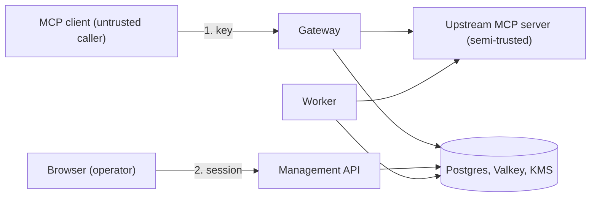

# Threat model (STRIDE)

Scope: the gateway (`/mcp`), the management API, the worker and the data they hold. Out of scope:
the security of the upstream MCP servers themselves and of the model behind an agent.

## Assets

1. Upstream credentials (bearer tokens, API keys, environment variables).
2. Client API keys.
3. The ability to call tools: what an agent can read or change through upstream servers.
4. The audit log and the catalog.
5. Dashboard accounts.

## Trust boundaries

1. A client key crosses the first boundary. 2. A session crosses the second. 3. Everything an
   upstream server returns is data from a semi-trusted party. 4. The data plane is trusted but must
   fail closed.

## Spoofing

| Threat                                              | Mitigation                                                                                                                                                 |
| --------------------------------------------------- | ---------------------------------------------------------------------------------------------------------------------------------------------------------- |
| Stolen or guessed client key                        | Keys carry 256 bits of randomness, only an HMAC is stored, keys expire and revoke instantly, the unknown-key answer is uniform and cached for a short time |
| Stolen dashboard session                            | HttpOnly, SameSite cookie, short-lived signed token, sign-out and password change revoke sessions, account lockout                                         |
| Forged `X-Forwarded-For` to dodge the sign-in limit | Proxy headers trusted only from the VPC range                                                                                                              |
| A fake upstream server impersonating a real one     | Servers are registered by an operator by URL; TLS is verified by the HTTP client; the catalog fingerprints tool definitions and records changes            |

## Tampering

| Threat                                                                                | Mitigation                                                                                                                                           |
| ------------------------------------------------------------------------------------- | ---------------------------------------------------------------------------------------------------------------------------------------------------- |
| An agent edits arguments to escape a constraint                                       | Constraints and the input schema are enforced by the gateway before the call leaves it                                                               |
| An upstream server silently changes a tool's description to steer agents ("rug pull") | Every tool definition has a SHA-256 fingerprint; changes create a dated version record with the diff, and changed tools are flagged in the dashboard |
| A ciphertext moved to another row                                                     | KMS encryption context (or AES-GCM associated data) binds a value to its server and secret name                                                      |
| Rule changes by a viewer                                                              | Role checks on every route; all changes are audited with the actor                                                                                   |
| Cache poisoning across clients                                                        | Cache keys include the client or key id and a generation counter; a view is rebuilt when the policy version differs                                  |

## Repudiation

| Threat                       | Mitigation                                                                                                                                                 |
| ---------------------------- | ---------------------------------------------------------------------------------------------------------------------------------------------------------- |
| "My agent never called that" | Every call is recorded with the client, the key, the request id and the redacted arguments, including refused ones                                         |
| An operator denies a change  | Administrative events record who, what and when; tool-tester calls record the operator's name                                                              |
| Log tampering                | The application has no update or delete route for the call log; retention deletes only by age. Ship the database's own audit trail for stronger guarantees |

## Information disclosure

| Threat                                  | Mitigation                                                                                                                                                         |
| --------------------------------------- | ------------------------------------------------------------------------------------------------------------------------------------------------------------------ |
| Secrets read through the API            | Secrets are write-only: no schema contains a value                                                                                                                 |
| Secrets in logs, audit rows and results | Credential patterns are masked in logs and audit text; injected secret values are masked in relayed results; recorded arguments are redacted by key and by pattern |
| One client learning another's tools     | A client sees only its compiled view; a hidden tool is indistinguishable from one that does not exist                                                              |
| Cloud credentials via SSRF              | Metadata and link-local targets are refused, including through DNS; private ranges need an explicit allow-list entry                                               |
| Error messages leaking internals        | One error envelope, generic 500s, upstream errors reduced to a safe message                                                                                        |
| Database dump                           | Secrets are ciphertext; keys are HMACs; passwords are Argon2 hashes                                                                                                |

## Denial of service

| Threat                     | Mitigation                                                                                                                 |
| -------------------------- | -------------------------------------------------------------------------------------------------------------------------- |
| A noisy client             | Per-client and per-rule fixed-window limits in Valkey (they fail open if Valkey is down, a deliberate availability choice) |
| A hung upstream            | Connect timeout, per-server call timeout, bounded result size, per-server pooled connection, idle connections reaped       |
| A huge request or result   | Body limit, result limit, argument truncation in the log                                                                   |
| Audit writes slowing calls | Buffered, batched writes off the request path; a bounded queue that drops and counts                                       |
| Brute-force sign-in        | Per-address rate limit and per-account lockout                                                                             |

## Elevation of privilege

| Threat                                               | Mitigation                                                                                                                          |
| ---------------------------------------------------- | ----------------------------------------------------------------------------------------------------------------------------------- |
| A client key used on the management API              | Refused: such keys work only at `/mcp`                                                                                              |
| A viewer reaching write routes                       | Role dependency on every route, tested per role                                                                                     |
| Launching arbitrary processes through a stdio server | Disabled unless the operator allow-lists the executable; arguments never go through a shell; AWS deployments disable stdio entirely |
| Reaching internal services through a registered URL  | Egress policy (see [security](security.md))                                                                                         |
| A role in AWS used to decrypt unrelated data         | Key use requires MCPHub's encryption context; secret access is limited to this deployment's names                                   |

## Residual risks

- **DNS rebinding.** The egress check resolves a name, then the HTTP client resolves it again. A
  hostile DNS server could answer differently. Pin upstream hosts with `UPSTREAM_ALLOWED_HOSTS`
  and use network policy (security groups, egress firewall) as the second layer.
- **Prompt injection through tool results.** The gateway does not interpret what a server returns.
  Fingerprinting and per-client rules limit what a poisoned tool can reach, not what it can say.
- **Shared upstream credentials.** A server's secrets are shared by every client allowed to call it.
  Per-client upstream credentials are future work.
- **Rate limits fail open** when Valkey is unreachable.
- **A stdio server is code the gateway host runs.** Treat the allow-list as a code-execution grant.
