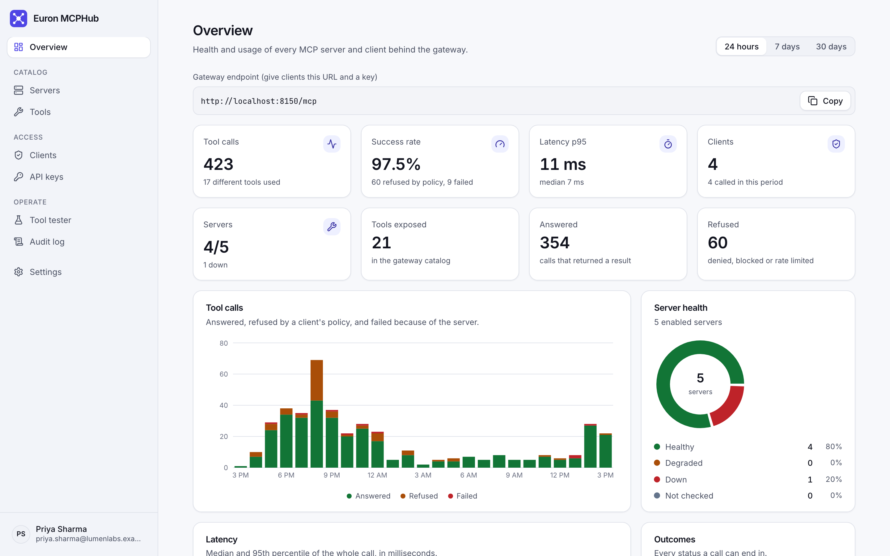
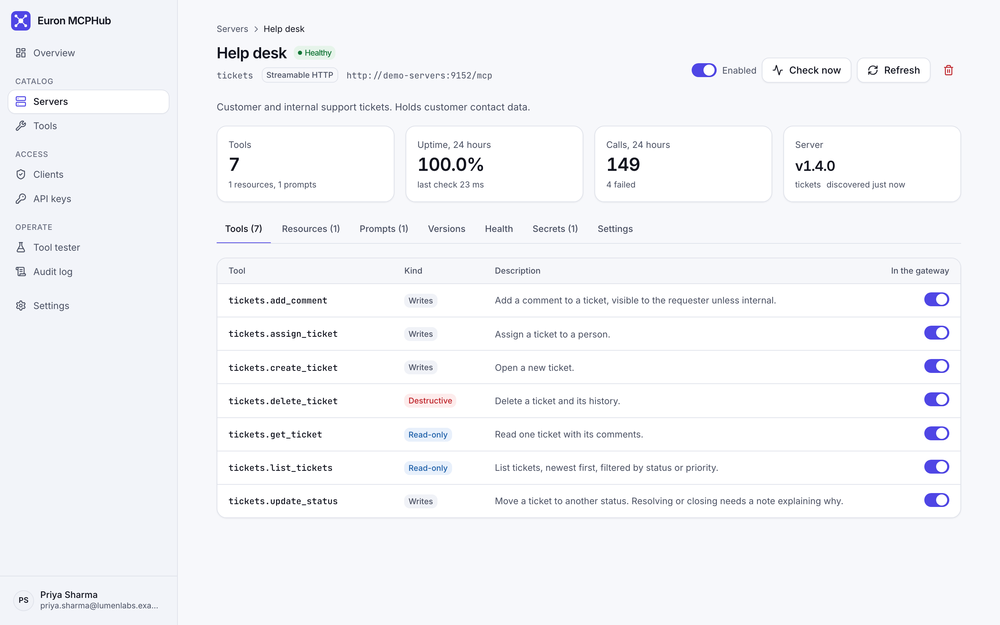
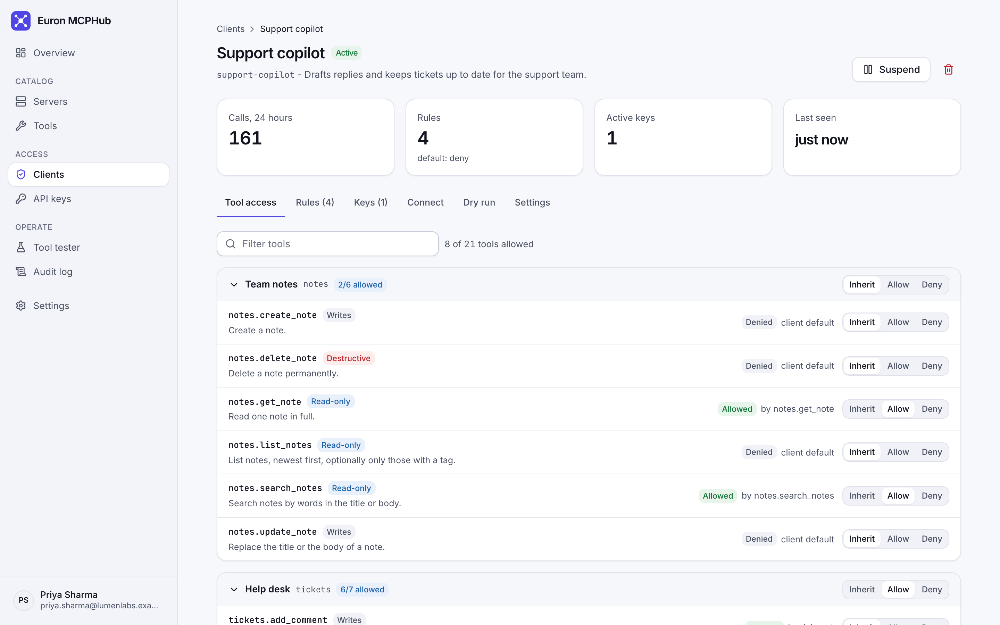
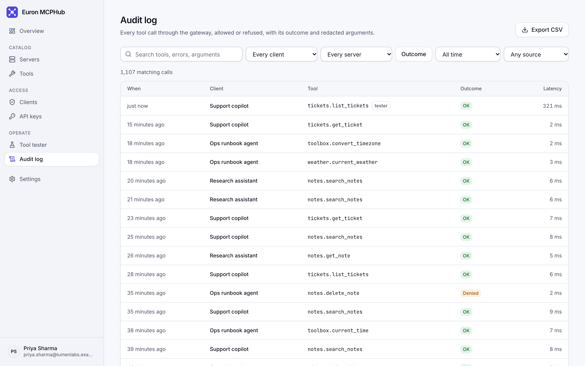

# Walkthrough

A tour of the product with the demo data (`make up demo`). Sign in as `priya.sharma@lumenlabs.example`
(admin) with the password from `deploy/compose/.env` (`MCPHUB_DEMO_PASSWORD`). The story: Lumen Labs runs five
MCP servers, and five clients (agents and tools) use them through MCPHub.

## 1. See what is running

The **Overview** shows the last 24 hours, 7 days or 30 days: calls answered, refused by policy and failed, the
busiest tools and clients, latency, and the health of every server. The gateway address is at the top: this is the one URL
every client uses.



## 2. Servers

**Servers** is the catalog. The help desk, the notes server, the toolbox and the stdio weather server are healthy; the warehouse
analytics server is down (it is being moved), and the page says so with the error. Open **Help desk**: its tools, resources and
prompts, its **Versions** (the 1.3.2 to 1.4.0 upgrade added `add_comment`: discovery recorded it with a date), its **Health**
history and its **Secrets**. The token it needs is listed by name only: no screen and no API call can show it again.



**Connect a server** walks through the address, the credentials and the discovery result. Try registering
`http://169.254.169.254/latest/meta-data`: the egress policy refuses it, and refuses private addresses that are not allow-listed.

## 3. Clients and permissions

**Clients** are the callers. Open **Support copilot**. The **Tool access** matrix lists every tool in the catalog: the badge shows what
the client gets and which rule decided it, and the control sets an exact rule (`Inherit` removes it). The copilot may use
`tickets.*` except `delete_ticket`, which is denied by a more specific rule. The **Rules** tab shows the constraint that keeps priorities
to `low`, `normal` and `high`, and the email that is kept out of the audit log. **Dry run** explains a call without making it.



**Connect** has snippets for the command line, IDEs, curl and Python, and **Keys** creates and revokes keys. A new key is shown once.

## 4. Try a tool

**Tool tester** calls a tool through the gateway as one of the clients: the same policy, limits and audit trail as any agent. Call
`tickets.list_tickets` as the support copilot, then call it as the research assistant, which has no access to customer data, and see
the refusal.

## 5. Read the audit log

The **Audit log** has every call: filter by client, server, outcome, time and source, or search arguments and errors. Open a denied call to
see why, when and by whom. Credentials in arguments are masked, and a client can turn argument recording off. Export the matching rows as CSV.



## 6. Settings

**Settings** has your profile and password, the people who can sign in (admins add them and hand over a one-time password), the activity
feed of who changed what, and the deployment details the API reports.

## From a script

```bash
curl -s http://localhost:8150/mcp -H "authorization: Bearer $KEY" \
  -H "content-type: application/json" -H "accept: application/json, text/event-stream" \
  -H "mcp-protocol-version: 2025-11-25" \
  -d '{"jsonrpc":"2.0","id":1,"method":"tools/call","params":{"name":"toolbox.calculate","arguments":{"expression":"6 * 7"}}}'
```
